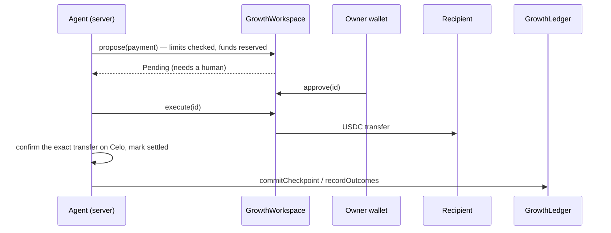
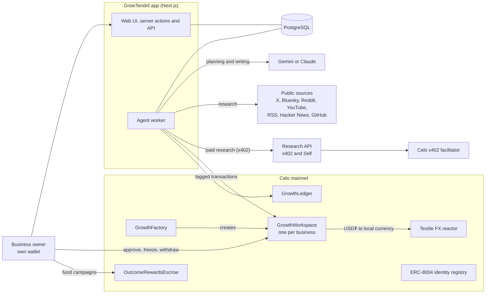
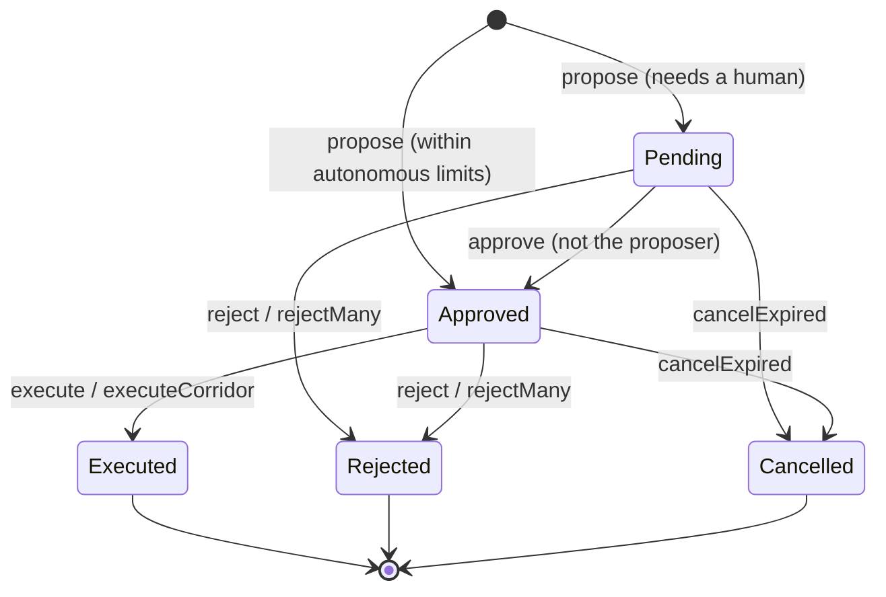

# GrowTendril

**An AI growth agent for small businesses, with every payment and spending rule enforced by smart contracts on Celo.**

[](https://github.com/drained69/growtendril-celo/actions/workflows/ci.yml)


**Live app:** [celo.growtendril.xyz](https://celo.growtendril.xyz) · **Agent identity:** [agent-registration.json](https://celo.growtendril.xyz/.well-known/agent-registration.json) · **Contracts:** [GrowthFactory on Celoscan](https://celoscan.io/address/0x22d56660f4b1251012f985c38fef07996175f3b1)

GrowTendril finds customers and creators for a small business. It proposes small growth experiments, pays people only under the owner's rules, measures what happened and moves budget toward what worked.

Each business gets its own workspace contract on Celo mainnet. The contract holds the business's USDC and USD₮, its spending limits, its missions and experiments, and its kill switch. The agent can propose payments and carry out approved ones. It can't pay a person without the owner's approval, go over a limit or withdraw funds, even if its key is stolen.

### Quick tour for reviewers

**Who holds the keys**

| Key | Can | Can't |
|---|---|---|
| Business owner's wallet | Own its workspace contract: approve payments to people, change limits, freeze, remove the agent, withdraw | Touch another business's workspace |
| Agent key (server) | Propose payments inside the rules, carry out approved ones, write results to the ledger | Approve its own payments, pay a person without approval, exceed a limit, withdraw |
| Deployer | Nothing after deployment. There is no admin, owner, upgrade or pause key | — |

**Where to look**

| What | Code |
|---|---|
| Spending rules and human approval | [`propose`](contracts/src/protocol/GrowthWorkspace.sol#L219) · [`_needsHuman`](contracts/src/protocol/GrowthWorkspace.sol#L256) · [`approve`](contracts/src/protocol/GrowthWorkspace.sol#L267) |
| Local-currency payout with an enforced minimum | [`executeCorridor`](contracts/src/protocol/GrowthWorkspace.sol#L336) · [`validateCorridorQuote`](src/server/integrations/celo/textile.ts#L47) · [`viaWorkspace`](src/server/domain/agent/corridor-payout.ts#L131) |
| Owner exit, even while frozen | [`withdraw`](contracts/src/protocol/GrowthWorkspace.sol#L355) |
| Tamper-evident record of results | [`commitCheckpoint`](contracts/src/protocol/GrowthLedger.sol#L38) · [`verifyRecord`](contracts/src/protocol/GrowthLedger.sol#L64) |
| Server checks before the owner signs | [`ensureVaultIntent`](src/server/integrations/celo/protocol.ts#L123) · [`vaultTermsProblem`](src/server/integrations/celo/protocol.ts#L167) |
| Self-gated paid research | [`selfIdentityGate`](services/signals-api/identity.ts#L21) |
| Attribution tag on every agent transaction | [`attributionSuffix`](src/server/integrations/celo/client.ts#L8) |
| ERC-8004 registration | [`celo-register.ts`](scripts/celo-register.ts#L24) |
| Owner wallet actions in the app | [`workspace-contract.tsx`](src/components/features/wallet/workspace-contract.tsx#L58) |

**How to check it**

- **Contract tests**, including 11 invariant fuzz rules that treat the agent key as stolen: [`Invariants.t.sol`](contracts/test/Invariants.t.sol). Run `cd contracts && forge test`.
- **The app against the real contracts** on a private Celo mainnet fork, in 22 checks: [`celo-e2e.ts`](scripts/celo-e2e.ts). Run `npm run celo:e2e`.
- **Deployed source** is verified on Sourcify. The [deployment record](contracts/deployments/celo-mainnet.json) has every transaction hash and a fingerprint of the deployed source.
- **CI** runs the type check, app tests, production build and contract tests on every push.

---

## Contents

1. [Overview](#overview)
2. [Features](#features)
3. [How it works](#how-it-works)
4. [Architecture](#architecture)
5. [Smart contracts](#smart-contracts)
6. [Celo integrations](#celo-integrations)
7. [Payment flows](#payment-flows)
8. [Technology and tools](#technology-and-tools)
9. [Repository structure](#repository-structure)
10. [Getting started](#getting-started)
11. [Configuration](#configuration)
12. [Scripts](#scripts)
13. [Testing](#testing)
14. [Deployment](#deployment)
15. [Security](#security)
16. [Project status](#project-status)
17. [Hackathon](#hackathon)
18. [Documentation](#documentation)
19. [Contributing](#contributing)
20. [License](#license)
21. [Acknowledgements](#acknowledgements)

---

## Overview

Small businesses need growth, but most can't afford a growth team, and few would trust an AI with their money. GrowTendril splits the work into two parts:

| Layer | Who controls it | What happens there |
|---|---|---|
| **Offchain** | The agent | Research, scoring, planning, outreach, measurement and learning |
| **Onchain** | The business | Funds, limits, approvals, payments and the public record of results |

The agent is treated as an untrusted operator. Its key could be stolen, its model could be wrong, and its sources could be manipulated. So every rule that protects the business's money is enforced by the workspace contract, not by the app. Nobody, including GrowTendril, can change those rules on the business's behalf.

## Features

| Feature | Description |
|---|---|
| **Demand discovery** | Searches public sources (X, Bluesky, Reddit, YouTube, RSS, Hacker News and GitHub) for buying intent, then scores prospective customers and creators. |
| **Growth plans** | Turns a goal and a budget into missions and small experiments, each with a clear success event. |
| **Creator campaigns** | Prefunded creator rewards held in an escrow contract, with a review window, a refund hold and a dispute path. |
| **Owner approvals** | Payments to people wait in **Approvals**. The owner checks the amount and recipient, then signs with their own wallet. |
| **Stablecoin payouts** | Pays in USDC or USD₮ on Celo, or in the recipient's local currency (cNGN, IDRX, wARS, wBRL, wMXN or wCOP) through Textile FX. |
| **Paid research** | The agent buys company and market research per request over x402, paid in Celo USDC. |
| **Research API** | An optional paid API (`services/signals-api`) sells the same research to other agents over x402, and only to Self-verified agents. |
| **Outcome measurement** | Tracks cohorts, activation, revenue, customer acquisition cost, lifetime value and payback for each experiment, using signed conversion events. |
| **Decision receipts** | Every agent decision gets a hashed receipt. Receipts are committed to a public onchain ledger that anyone can verify. |
| **Learning loop** | After each cycle the agent moves unspent budget toward the experiments that worked, within the onchain limits. |
| **Agent wallets** | An optional passkey-owned Altana smart wallet, with a capped, expiring session key for the agent. |
| **Team and alerts** | Owner, admin, member and viewer roles in the app, email notifications and a daily brief. |
| **Kill switch** | The owner can freeze spending, remove the agent or withdraw all unreserved funds at any time. |

## How it works

1. **Discover and plan.** The agent researches demand, scores customers and creators, and drafts an experiment inside a mission budget.
2. **Propose onchain.** The agent proposes the payment to the workspace contract. The contract refuses anything over the hard ceiling or the mission or experiment budget, decides from the per-transaction limit, daily limit and category budget whether a human must approve, and reserves the funds.
3. **Approve.** A payment to a person always needs approval from someone other than the agent, signed in that person's own wallet. Small payments to services the owner has approved can run on their own, within the owner's limits.
4. **Pay.** The agent carries out the approved payment in USDC or USD₮. For a local-currency payout, the contract converts USD₮ through Textile FX and delivers the result in one atomic transaction. The app marks a payment settled only after Celo shows the exact transfer.
5. **Record and learn.** Outcomes and decision receipts are committed to the ledger contract, and the agent moves budget toward what worked.



## Architecture



| Component | Description |
|---|---|
| **Web app** | Next.js App Router application: marketing site, sign-in, the workspace UI under `/app`, billing, a creator escrow portal and the API. |
| **Agent worker** | Runs scheduled agent cycles (hourly, every 6 hours or daily) in the same Node.js process as the web app, or alone with `npm run worker`. Jobs are deduplicated by time bucket, so several workers never repeat work. |
| **Database** | PostgreSQL through Drizzle ORM. It stores accounts, research, plans, approvals and the payment state machine. Without `DATABASE_URL`, a local PGlite database opens in `.data/`. |
| **Agent wallet** | One server key (`CELO_AGENT_PRIVATE_KEY`). On each workspace contract it holds only the operator role. Its own wallet, used to buy research and hold the agent's identity, is bound to one workspace with `CELO_AGENT_PROJECT_ID`. Browsers and language models never see it. |
| **Research API** | An optional Express service (`services/signals-api`) that sells research over x402 and accepts only Self-verified agents. |
| **Contracts** | Four immutable Solidity contracts on Celo mainnet. See [Smart contracts](#smart-contracts). |

---

## Smart contracts

Source: [`contracts/src`](contracts/src). Built with Foundry, Solidity 0.8.30, optimizer on with 200 runs, EVM version `cancun`. The contracts have no external dependencies.

The contracts are immutable. There is no admin key, upgrade path, pause key or protocol fee, and the workspace contract can't sign messages for itself (no ERC-1271).

### Deployed contracts (Celo mainnet, chain ID 42220)

Deployed on November 25, 2026 at 21:04 UTC. All four contracts are source-verified on [Sourcify](https://sourcify.dev), and each deployment transaction carries the Celo attribution tag.

| Contract | Address | Deployment |
|---|---|---|
| **GrowthFactory** | [`0x22d56660f4b1251012f985c38fef07996175f3b1`](https://celoscan.io/address/0x22d56660f4b1251012f985c38fef07996175f3b1) | [Transaction](https://celoscan.io/tx/0xac1c864b12dcb863b9b57b4db13bb3b387c7bfd2e9f0854cfa4934592a17b2e8), block 83,739,891 |
| **GrowthWorkspace** (template behind every workspace) | [`0x5F7E160E292E9Dd0077D9dc6B84Bbcc404F5fb1C`](https://celoscan.io/address/0x5F7E160E292E9Dd0077D9dc6B84Bbcc404F5fb1C) | Created by the factory's constructor in the same transaction |
| **GrowthLedger** | [`0x41289019c57389874ee81600c605bdfea671ee5e`](https://celoscan.io/address/0x41289019c57389874ee81600c605bdfea671ee5e) | [Transaction](https://celoscan.io/tx/0xe149664a6d0042972ab4e9d28c2afa0cd1827abc866d1b87842e9bb1bdfec806), block 83,739,895 |
| **OutcomeRewardsEscrow** | [`0x3157ed9d980dd30f419419145c1fcb481789fe15`](https://celoscan.io/address/0x3157ed9d980dd30f419419145c1fcb481789fe15) | [Transaction](https://celoscan.io/tx/0x0ce72401a474a6a8abea18126ff8211796237e72be7e40b523711f3d11f59465), block 83,739,885 |

The full record, with the deployer, compiler settings and a fingerprint of the deployed source, is in [`contracts/deployments/celo-mainnet.json`](contracts/deployments/celo-mainnet.json).

**Constructor configuration** (read back from the chain after deployment):

| Contract | Constructor arguments |
|---|---|
| GrowthFactory | USDC, USD₮, the Textile FX reactor, and the six payout tokens listed under [External contracts](#external-contracts) |
| GrowthLedger | GrowthFactory `0x22d5…f3b1` |
| OutcomeRewardsEscrow | USDC and a refund hold of `259200` seconds (72 hours) |

### Contract overview

| Contract | Role |
|---|---|
| [`GrowthFactory`](contracts/src/protocol/GrowthFactory.sol) | Creates one isolated workspace per business, at an address derived from the owner's address. It has no owner and can't touch funds. |
| [`GrowthWorkspace`](contracts/src/protocol/GrowthWorkspace.sol) | One business's treasury and rules: team roles, spending policy, missions, experiments, payees, payment intents, payouts and the kill switch. |
| [`GrowthLedger`](contracts/src/protocol/GrowthLedger.sol) | A public, hash-chained record of what the agent saw, decided, measured and learned, plus cumulative experiment outcomes. |
| [`OutcomeRewardsEscrow`](contracts/src/OutcomeRewardsEscrow.sol) | Prefunded creator rewards with immutable terms, a review window, a refund hold, a single dispute and an arbiter timeout. |

### GrowthFactory

Each workspace is an [EIP-1167](https://eips.ethereum.org/EIPS/eip-1167) minimal proxy of the `GrowthWorkspace` template, created with `CREATE2`. The salt is `keccak256(abi.encode(owner, ref))`, so only the owner can create their workspace at that address, and nobody can take it first.

| Function | Who can call | What it does |
|---|---|---|
| `createWorkspace(ref, operator, policy)` | Anyone (the caller becomes the owner) | Creates and initializes a workspace, grants the operator role and sets the first policy |
| `addressOf(owner, ref)` | View | Predicts a workspace's address before it exists |
| `isWorkspace(address)` | View | True only for workspaces this factory created |
| `isPayoutToken(address)` | View | True for the six allowed local-currency payout tokens |

Event: `WorkspaceCreated(workspace, owner, ref, operator)`.

### GrowthWorkspace

**Roles.** Roles are a bitmask. The owner implicitly holds every role.

| Role | Value | Can | Can't |
|---|---|---|---|
| Owner | — | Everything, including withdrawing unreserved funds even while frozen, and transferring ownership in two steps | Touch another business's workspace |
| Admin | `1` | Set policy, manage approvers and operators, open and update missions, stop experiments, approve services, freeze and unfreeze, approve and reject payments | Withdraw, or manage other admins |
| Approver | `2` | Approve or reject payments, freeze | Change policy or unfreeze |
| Operator (the agent) | `4` | Propose payments, open experiments within a mission budget, add new payees, move budget between experiments within limits, carry out approved payments, write to the ledger | Approve its own proposals, withdraw, change policy or roles, overwrite a payee, pay a person without approval, exceed any limit |

**Spending policy.**

| Field | Meaning |
|---|---|
| `autonomyEnabled` | Whether any payment can run without a human |
| `maxTransaction` | Largest payment that can run without a human |
| `dailySpend` | Total that can run without a human per UTC day |
| `hardCeiling` | Largest single payment, approved or not |
| `autonomousCategories` | Bitmask of categories allowed to run on their own |
| `approvalCategories` | Bitmask of categories that always need a human |

Amounts use 6 decimals, the same as USDC and USD₮. The seven spending categories are `research`, `services`, `kol`, `bounty`, `content`, `community` and `treasury`.

**When a human must approve.** A payment runs on its own only if autonomy is on, it pays an approved service rather than a person, it is not a currency conversion, its category doesn't require approval, and it fits within the per-transaction limit, the daily limit and the category budget. Every other payment waits for a human.

**Payment lifecycle.**



A payment intent lives for at most 30 days. Rejecting or cancelling it releases its reserved funds and budget.

**Functions.**

| Area | Functions |
|---|---|
| Team | `setRole`, `offerOwnership`, `acceptOwnership`, `hasRole` |
| Policy and kill switch | `setPolicy`, `setFrozen`, `setService` |
| Payees | `registerPayee` (adding a payee starts a 24-hour hold before the same person can approve a payment to it) |
| Missions | `openMission` (with per-category budgets), `updateMission` (can't go below current commitments) |
| Experiments | `openExperiment`, `stopExperiment` (returns unspent budget to the mission), `reallocate` (large moves need an admin) |
| Payments | `propose`, `approve`, `reject`, `rejectMany`, `cancelExpired`, `execute`, `executeCorridor`, `intentOf` |
| Exit | `withdraw` (owner only; works while frozen; can't touch reserved funds) |

**Local-currency payouts.** `executeCorridor` approves exactly the approved USD₮ to the Textile FX reactor, runs the quoted swap, resets the allowance to zero and delivers the local stablecoin to the recipient. The transaction reverts if it spends more USD₮ than approved or delivers less than the approved minimum.

**Events:** `RoleSet`, `OwnershipOffered`, `OwnershipAccepted`, `PolicySet`, `FrozenSet`, `ServiceSet`, `PayeeRegistered`, `MissionOpened`, `MissionUpdated`, `ExperimentOpened`, `ExperimentStopped`, `BudgetReallocated`, `IntentProposed`, `IntentApproved`, `IntentClosed`, `IntentExecuted` and `Withdrawn`.

### GrowthLedger

AI output and web research stay offchain. Their results are committed to the ledger as Merkle roots in a hash chain, so a stored record can't later be changed, reordered or removed without detection. Only a workspace's owner, admins and operator can write to it.

| Function | What it does |
|---|---|
| `commitCheckpoint(workspace, root, records, expectedHead)` | Adds a checkpoint. The new head is `keccak256(abi.encode(previousHead, workspace, number, root, records))`. Passing `expectedHead` stops two writers from forking the chain. |
| `recordOutcomes(workspace, experimentId, totals, evidenceRoot)` | Records cumulative customers, activations, paying customers, revenue and refunds. Totals can only rise, and must stay consistent. |
| `recordLearning(workspace, missionId, findingsRoot, verdict)` | Records what a mission taught the agent. |
| `verifyRecord(workspace, number, leaf, proof)` | Lets anyone prove that a receipt, signal or decision belongs to a committed checkpoint. Leaves are hashed once more, so an internal tree node can't pass as a record. |

Events: `CheckpointCommitted`, `OutcomesRecorded` and `LearningRecorded`.

### OutcomeRewardsEscrow

A business prefunds a creator campaign in USDC. Its terms can't be changed after funding, and recipients can't be edited. Whether a creator's work met the bar remains the business's call, but the escrow limits what the business can do with that call.

**Reward formula:** `base + qualityBonus × quality / 100 + outcomeBonus × outcomes`, where `quality` is 0–100 and `outcomes` is capped by the campaign's `outcomeCap` (at most 100). A campaign has up to 1,000 slots and must be funded for the maximum payout of every slot.

| Constant | Value | Purpose |
|---|---|---|
| `refundHold` | 72 hours | Time between queueing a reward and claiming it, so merchant refunds can be applied |
| `REVIEW_WINDOW` | 7 days | Period after the deadline when the owner queues rewards |
| `DISPUTE_TIMEOUT` | 14 days | After this, a disputed reward resolves for the recipient if the arbiter stays silent |
| `MIN_DISPUTE_TIME` | 1 day | A recipient always has at least this long to dispute a cut |
| `MAX_CAMPAIGN_LENGTH` | 365 days | Furthest a deadline can be set |

| Function | Who can call | What it does |
|---|---|---|
| `createCampaign` | Funder | Creates and funds a campaign. The campaign ID is derived from the funder's address. |
| `queueReward` | Campaign owner | Queues one reward per recipient during the review window |
| `reduceOutcomes` | Campaign owner | Lowers outcomes after a merchant refund. Allowed only before any dispute, and only while the recipient still has a day to dispute. Base and quality payments stay protected. |
| `dispute` | Owner or recipient | Raises the reward's single dispute before it becomes claimable |
| `resolve` | Arbiter | Releases or denies a disputed reward. A denial frees the slot. |
| `claim` | Anyone | Pays the bound recipient once the hold has passed and any dispute is resolved or timed out |
| `refundUnused` | Campaign owner | Returns unused funds after the review window closes |
| `campaignKey` | View | Computes a campaign ID from a funder and salt |

Events: `CampaignFunded`, `RewardQueued`, `OutcomesReduced`, `RewardDisputed`, `DisputeResolved`, `RewardPaid` and `UnusedRefunded`.

### Guarantees enforced onchain

- Funds reserved for open payments can't be withdrawn until those payments are rejected, cancelled or executed.
- Mission and experiment spending never exceeds their budgets.
- A payment to a person always needs approval from someone other than the proposer.
- Whoever adds a payee must wait 24 hours before approving a payment to that payee.
- Payments are rechecked against the policy in force when they execute, so tightening a limit also covers payments already queued.
- A local-currency payout spends at most the approved USD₮, delivers at least the approved minimum, leaves no allowance open, and is atomic.
- The agent's key can't withdraw, change rules or roles, or approve its own proposals.
- Ledger outcome totals only rise, and checkpoints can't fork, skip or rewrite the hash chain.
- Each escrow reward is paid at most once, for its recorded amount, and only to its bound recipient.

### External contracts

Contracts on Celo mainnet that GrowTendril calls or integrates with:

| Contract | Address | Used for |
|---|---|---|
| USDC | [`0xcebA9300f2b948710d2653dD7B07f33A8B32118C`](https://celoscan.io/address/0xcebA9300f2b948710d2653dD7B07f33A8B32118C) | Workspace funds, payouts, x402 payments, creator escrow and billing |
| USD₮ | [`0x48065fbBE25f71C9282ddf5e1cD6D6A887483D5e`](https://celoscan.io/address/0x48065fbBE25f71C9282ddf5e1cD6D6A887483D5e) | Workspace funds and the source currency for local-currency payouts |
| Textile FX LimitOrderReactor | [`0xa9AA0a64769cBed4d3B1Ceb4Df01CdE915C235b3`](https://celoscan.io/address/0xa9AA0a64769cBed4d3B1Ceb4Df01CdE915C235b3) | Settles USD₮ to local-currency conversions |
| ERC-8004 identity registry | [`0x8004A169FB4a3325136EB29fA0ceB6D2e539a432`](https://celoscan.io/address/0x8004A169FB4a3325136EB29fA0ceB6D2e539a432) | Registers the agent's onchain identity |

**Local-currency payout tokens** (all six are registered in the deployed factory):

| Token | Currency | Address | Decimals |
|---|---|---|---|
| cNGN | Nigerian naira | [`0xF6829D7393dAe24509eb1E52eE8e572e2E271a4f`](https://celoscan.io/address/0xF6829D7393dAe24509eb1E52eE8e572e2E271a4f) | 6 |
| IDRX | Indonesian rupiah | [`0x18Bc5bcC660cf2B9cE3cd51a404aFe1a0cBD3C22`](https://celoscan.io/address/0x18Bc5bcC660cf2B9cE3cd51a404aFe1a0cBD3C22) | 2 |
| wARS | Argentine peso | [`0x0DC4F92879B7670e5f4e4e6e3c801D229129D90D`](https://celoscan.io/address/0x0DC4F92879B7670e5f4e4e6e3c801D229129D90D) | 18 |
| wBRL | Brazilian real | [`0xD76f5Faf6888e24D9F04Bf92a0c8B921FE4390e0`](https://celoscan.io/address/0xD76f5Faf6888e24D9F04Bf92a0c8B921FE4390e0) | 18 |
| wMXN | Mexican peso | [`0x337E7456B420bD3481e7FA61fA9850343d610d34`](https://celoscan.io/address/0x337E7456B420bD3481e7FA61fA9850343d610d34) | 18 |
| wCOP | Colombian peso | [`0x8a1D45e102e886510e891d2Ec656a708991e2D76`](https://celoscan.io/address/0x8a1D45e102e886510e891d2Ec656a708991e2D76) | 18 |

Each business may also use an **Altana smart wallet**: a passkey-owned contract account on Celo, created per business. Its address is the business's own, so it isn't listed here.

The full trust model, invariants and known limits are in [the protocol notes](docs/celo/PROTOCOL.md).

---

## Celo integrations

| Integration | How GrowTendril uses it | Code |
|---|---|---|
| **Celo mainnet** | The only chain the app spends on. Every transaction is signed for chain ID 42220, direct payments and x402 payments first confirm the RPC is Celo mainnet, and cross-chain spending is disabled. | [`config.ts`](src/server/integrations/celo/config.ts), [`client.ts`](src/server/integrations/celo/client.ts) |
| **Stablecoins** | USDC and USD₮ hold workspace funds and pay people. Balances and settlements are read straight from the token contracts and their `Transfer` logs. Native CELO is used only for gas. | [`wallet-balance.ts`](src/server/integrations/celo/wallet-balance.ts), [`billing/celo.ts`](src/server/domain/billing/celo.ts) |
| **Workspace contracts** | Hold each business's funds and enforce its rules. The app links a workspace only if it came from the factory, was created for that business and grants the agent the operator role. | [`protocol.ts`](src/server/integrations/celo/protocol.ts) |
| **Attribution tags (ERC-8021)** | Every transaction the agent sends carries the issued attribution tag as calldata. The app refuses to sign without one. | [`client.ts`](src/server/integrations/celo/client.ts) |
| **x402 v2, buyer** | The agent pays for research per request. It reads the seller's quote, applies the spending policy, then signs a USDC authorization for that exact amount. The signer refuses anything that isn't a Celo USDC authorization. | [`x402.ts`](src/server/integrations/celo/x402.ts), [`signer.ts`](src/server/integrations/celo/signer.ts) |
| **x402 v2, seller** | The research API charges for endpoints through Celo's x402 facilitator and settles to a PayTo address. A failed response is never charged. | [`services/signals-api`](services/signals-api) |
| **Self Agent ID** | Proves a verified human stands behind the agent. The agent signs its research requests with it, and the research API checks callers' Self identity before payment. The payer must be that same verified identity. | [`self.ts`](src/server/integrations/celo/self.ts) |
| **ERC-8004** | Registers the agent's onchain identity. Its public metadata is served at `/.well-known/agent-registration.json`. | [`celo-register.ts`](scripts/celo-register.ts), [route](src/app/.well-known/agent-registration.json/route.ts) |
| **Textile FX** | Converts approved USD₮ into a local stablecoin. Before signing, the app checks the quote's settlement contract, wallet, chain, amount and expiry, and refuses a minimum payout below 85% of the live rate. | [`textile.ts`](src/server/integrations/celo/textile.ts), [`corridors.ts`](src/server/integrations/celo/corridors.ts) |
| **Altana agent wallets** | The business owns a passkey wallet. The server creates a session key for the agent, sends only its public key to the browser, stores the private key encrypted, and treats the key as granted or revoked only after reading the wallet contract. The grant limits which token functions the agent can call and how much it can spend per day, week or month. | [`altana.ts`](src/server/integrations/celo/altana.ts) |
| **Browser wallets** | Owners approve payments, freeze spending and withdraw from their own wallet. The app switches the wallet to Celo mainnet, or adds the network if needed. | [`celo-browser.ts`](src/lib/celo-browser.ts) |

## Payment flows

| Flow | Path |
|---|---|
| **Pay a person** | Agent proposes → contract reserves funds → owner approves in their wallet → agent executes → app confirms the exact USDC or USD₮ transfer on Celo |
| **Local-currency payout** | Agent proposes a USD₮ payment with a minimum payout → owner approves → app gets a firm Textile FX quote → contract converts and delivers atomically → app confirms delivery |
| **Paid research (buyer)** | Agent fetches the 402 quote → policy check → signs the exact USDC amount → seller settles on Celo → app records the settlement transaction |
| **Paid research (seller)** | Caller signs with Self → identity check → x402 payment → research response; failed responses aren't charged |
| **Creator rewards** | Business funds a campaign in escrow → creators deliver → business queues rewards → 72-hour hold, with a dispute path → anyone relays the claim to the creator |
| **Service credit** | The customer sends USDC to the billing address → the app matches the `Transfer` log to an invoice → credit is added. Native CELO never pays an invoice. |

If a payment's result can't be confirmed (for example, a seller or relay stops responding after a signed authorization has been sent), the funds stay committed and the payment is flagged for review. It is never sent twice automatically.

---

## Technology and tools

### Application

| Tool | Version | Used for |
|---|---|---|
| [Next.js](https://nextjs.org) | 15.5 | Web framework: App Router, server components, server actions and API routes |
| [React](https://react.dev) | 19 | User interface |
| [TypeScript](https://www.typescriptlang.org) | 5.9 | Language for the app, services, scripts and tests |
| [Tailwind CSS](https://tailwindcss.com) | 4 | Styling, through `@tailwindcss/postcss` and PostCSS |
| [Lucide](https://lucide.dev) | `lucide-react` | Icons |
| [Fontsource](https://fontsource.org) | — | Self-hosted Hanken Grotesk, JetBrains Mono and Shantell Sans fonts |
| [Zod](https://zod.dev) | 4 | Validating external API responses, including Textile FX quotes |
| [Express](https://expressjs.com) | 5 | HTTP server for the research API |
| [tsx](https://tsx.is) | 4 | Runs TypeScript scripts, the worker and the research API |
| `server-only` | — | Stops server modules from being bundled into browser code |

### Blockchain

| Tool | Used for |
|---|---|
| [viem](https://viem.sh) 2 | Every Celo read and write: clients, contract calls, ABI encoding, typed-data signing, log scanning and nonce management |
| [`@celo/attribution-tags`](https://github.com/celo-org/attribution-tags) | Encodes the attribution tag appended to every transaction |
| [`@x402/core`, `@x402/evm`, `@x402/express`](https://www.x402.org) | x402 v2 payments: the buyer's exact-payment scheme and the seller's payment middleware |
| [`@selfxyz/agent-sdk`](https://docs.self.xyz/docs/agent-id/overview/) | Self Agent ID request signing and verification on mainnet |
| [`@altananetwork/sdk`](https://altana.network) | Altana smart wallets, session keys and relayed execution |
| [Solidity](https://soliditylang.org) 0.8.30 | Smart contract language |
| [Foundry](https://getfoundry.sh) | `forge` to build and test contracts, including invariant fuzzing; `anvil` for private Celo mainnet forks |
| [Sourcify](https://sourcify.dev) | Public source verification of the deployed contracts |
| [Celoscan](https://celoscan.io) | Block explorer links, and optional source publication with `ETHERSCAN_API_KEY` |

### Data and security

| Tool | Used for |
|---|---|
| [PostgreSQL](https://www.postgresql.org) with [`pg`](https://node-postgres.com) | Production database |
| [Drizzle ORM](https://orm.drizzle.team) and `drizzle-kit` | Schema, queries and migrations |
| [PGlite](https://pglite.dev) | Embedded PostgreSQL for local development and tests |
| Node.js `crypto` | AES-256-GCM encryption of stored secrets, scrypt password hashing, HMAC-signed conversion events and Ed25519-signed portable receipts |

### External services

| Service | Used for |
|---|---|
| [Forno](https://docs.celo.org) (`forno.celo.org`) | Default Celo mainnet RPC; any RPC can be set with `CELO_MAINNET_RPC` |
| [Celo x402 facilitator](https://x402.celo.org) | Verifies and settles x402 payments for the research API |
| [Textile FX API](https://app.textilecredit.com) | Price previews and firm quotes for local-currency conversions |
| [Self](https://docs.self.xyz/docs/agent-id/overview/) | Human-backed agent identity, proven with a passport |
| [Altana](https://altana.network) | Passkey smart wallets and the transaction relay |
| [Google Gemini](https://ai.google.dev) | Default language model for planning and writing, with a fallback list of models |
| [Anthropic Claude](https://www.anthropic.com/api) | Alternative language model, through `@anthropic-ai/sdk` |
| [Resend](https://resend.com) | Verification codes, invites, billing notices and alerts by email |
| [Google OAuth](https://developers.google.com/identity) | "Continue with Google" sign-in |
| X API, Bluesky, Reddit, YouTube Data API, GitHub REST API, Hacker News (Algolia) and RSS | Public research sources. Bluesky, Hacker News, Reddit and RSS work without keys; a source that needs credentials stays off until they are set. No source ever returns made-up results. |

### Development and operations

| Tool | Used for |
|---|---|
| [Vitest](https://vitest.dev) | Application test suite |
| [GitHub Actions](https://github.com/features/actions) | Type check, app tests, production build and contract tests on every push to `main` |
| [Docker](https://www.docker.com) | Production image on Node.js 22 |
| [Railway](https://railway.com) | Hosting for the web app and the optional research API, with the Railway CLI for settings uploads |

---

## Repository structure

```
contracts/                  Solidity contracts, Foundry tests and deployment records
  src/protocol/             GrowthFactory, GrowthWorkspace, GrowthLedger
  src/                      OutcomeRewardsEscrow
  test/                     Unit tests, invariant tests and a forked-USDC test
  deployments/              Deployment records, including celo-mainnet.json
src/
  app/                      Next.js routes: marketing site, sign-in, workspace UI (/app/*), billing, creator portal, API
  components/               UI components
  lib/                      Shared helpers, contract ABIs, the browser wallet client and Merkle utilities
  server/
    actions/                Server actions behind the UI
    auth/                   Sessions, passwords and Google sign-in
    db/                     Database schema and client
    domain/                 Agent, growth, scoring, billing, notifications and reconciliation logic
    integrations/celo/      Contracts, stablecoins, x402, Self, Textile FX, Altana and attribution
    integrations/llm/       Gemini and Claude clients
    integrations/providers/ Public research sources
    jobs/                   Scheduler, queue and background worker
    security/               Encryption, HMAC and safe outbound HTTP
services/signals-api/       Optional paid research API (x402 and Self)
packages/growth-tools/      Shared toolkit: escrow artifact, outcome, policy and evidence helpers
scripts/                    Deploy, register, readiness, end-to-end, settings and reconciliation scripts
drizzle/                    Database migrations
tests/                      Application tests
docs/                       User guide, protocol notes, runbooks and validation results
```

---

## Getting started

### Prerequisites

- Node.js 22 (22.12 or later), 24, or 26 and later
- npm
- [Foundry](https://getfoundry.sh), for the contracts and the fork tests
- Optional: PostgreSQL. Without it, a local PGlite database is used.

### Run the app locally

```sh
git clone https://github.com/drained69/growtendril-celo.git
cd growtendril-celo
npm ci
cp .env.example .env
```

Set `APP_URL` in `.env`:

```sh
APP_URL=http://localhost:3000
```

Start the development server:

```sh
npm run dev
```

Open [http://localhost:3000](http://localhost:3000).

In development, `SESSION_SECRET` and `ENCRYPTION_KEY` are generated automatically under `.data/`. Integrations you haven't configured stay off and never fabricate results.

### Build and test the contracts

```sh
cd contracts
forge build
forge test --no-match-contract Fork
```

---

## Configuration

All settings are environment variables. [`.env.example`](.env.example) lists every one with a short explanation. Keep every secret on the server, and never prefix one with `NEXT_PUBLIC_`.

| Group | Variables | Notes |
|---|---|---|
| **Core** | `DATABASE_URL`, `APP_URL`, `SESSION_SECRET`, `ENCRYPTION_KEY` | Required in production. `SESSION_SECRET` needs at least 32 characters; `ENCRYPTION_KEY` must be 32 bytes. `openssl rand -hex 32` produces a value that works for either. |
| **Agent wallet** | `CELO_AGENT_PRIVATE_KEY`, `CELO_AGENT_PROJECT_ID`, `CELO_ATTRIBUTION_CODE`, `CELO_AGENT_ID`, `CELO_MAINNET_RPC` | A dedicated key bound to one workspace. The app won't sign without the attribution tag. |
| **Contracts** | `CELO_GROWTH_FACTORY`, `CELO_GROWTH_LEDGER`, `CELO_REWARDS_ESCROW` | Addresses printed by `npm run celo:deploy`. |
| **Identity** | `SELF_AGENT_ENABLED` | Set to `1` only after the agent wallet has completed Self Agent ID. |
| **Payments** | `TEXTILE_API_KEY`, `CELO_RESEARCH_URLS`, `BILLING_CELO_ADDRESS` | Textile partner key, x402 research sellers to buy from, and the address that receives customer credit top-ups. |
| **Research API** | `X402_API_KEY`, `SIGNALS_PUBLIC_URL`, `SIGNALS_SELLER_ADDRESS`, `SIGNALS_API_PORT` | Only for running `services/signals-api`. |
| **AI** | `GEMINI_API_KEY`, `GEMINI_MODEL`, `ANTHROPIC_API_KEY`, `ANTHROPIC_WORKSPACE_ID`, `LLM_PROVIDER` | Gemini is used when its key is set, otherwise Claude. `LLM_PROVIDER` forces one. |
| **Research sources** | `GITHUB_TOKEN`, `X_BEARER_TOKEN`, `YOUTUBE_API_KEY`, `REDDIT_CLIENT_ID`, `REDDIT_CLIENT_SECRET`, `REDDIT_USER_AGENT`, `RSS_FEEDS` | All optional. |
| **Email and sign-in** | `RESEND_API_KEY`, `EMAIL_FROM`, `OPERATOR_EMAIL`, `GOOGLE_CLIENT_ID`, `GOOGLE_CLIENT_SECRET` | The Google redirect URI is `<APP_URL>/api/auth/google/callback`. |
| **Receipts and scheduling** | `CELO_RECEIPT_SIGNING_KEY`, `CRON_SECRET` | Optional Ed25519 key for portable receipts, and a secret for an external scheduler. |
| **Deployment** | `CELO_DEPLOYER_PRIVATE_KEY`, `ETHERSCAN_API_KEY` | Optional separate deployer, and optional Celoscan source publication. |

## Scripts

| Command | What it does |
|---|---|
| `npm run dev` | Starts the app in development mode on port 3000 |
| `npm run build` / `npm start` | Production build and server |
| `npm run typecheck` | TypeScript check |
| `npm test` | Application test suite (Vitest) |
| `npm run worker` | Runs the agent worker on its own |
| `npm run signals` | Starts the optional paid research API |
| `npm run doctor` | Readiness check for production: names every missing setting and checks balances and identity onchain |
| `npm run celo:e2e` | Runs the app against the real contracts on a private Celo mainnet fork |
| `npm run celo:deploy` | Deployment preflight: cost, balance and readiness. Sends nothing. |
| `npm run celo:deploy -- --rehearse` | Full deployment and a real-USDC payment on a private fork |
| `npm run celo:deploy -- --broadcast --confirm-mainnet` | Deploys to Celo mainnet. Spends real CELO. |
| `npm run celo:deploy -- --verify` | Retries source verification of a finished deployment |
| `npm run celo:register` | Previews the ERC-8004 registration. Add `-- --submit` to send it. |
| `npm run celo:env:push` | Uploads allowed settings to the hosted app. Never uploads private keys. |
| `npm run ledger:exceptions` | Lists payments where the app's records and the chain disagree, so they can be reviewed |
| `npm run db:generate` | Generates a database migration |

## Testing

```sh
npm run typecheck
npm test
cd contracts && forge test --no-match-contract Fork && cd ..
npm run celo:e2e
npm run celo:deploy -- --rehearse
```

None of these send a real transaction. `celo:e2e` and `--rehearse` need `anvil` from Foundry and start a private fork of Celo mainnet.

| Suite | Coverage |
|---|---|
| Application tests | 417 tests in 45 files: payments, policy, receipts, x402, Textile FX, Self, Altana, billing, authentication, security boundaries and the growth domain |
| Contract tests | 52 Foundry tests, including 11 invariant tests |
| Invariant fuzzing | 11 safety rules, each checked across 512,000 random actions with the agent's key treated as stolen |
| Forked-USDC test | The escrow against the real Celo USDC contract |
| End-to-end fork test | 22 checks of the real server code against the real contracts |

The end-to-end run checks that:

- A person can't be paid without the owner's onchain approval, and the server key can't bypass it.
- A payment is marked settled only after Celo shows the exact transfer.
- Rejection frees reserved funds, and the kill switch stops new payments.
- The owner can remove and restore the agent, and withdraw all unreserved funds.
- Outcomes and decision receipts are recorded onchain, and a forged record fails verification.

Full results are in [Validation](docs/celo/VALIDATION.md).

## Deployment

- **Contracts.** Follow [the mainnet runbook](docs/celo/MAINNET_RUNBOOK.md). Deployment is resumable, tags every transaction, re-reads the deployed settings and publishes the source for verification.
- **App.** The [`Dockerfile`](Dockerfile) builds a Node.js 22 image that serves on port 3000; development tools are pruned from the final image. Upload settings with `npm run celo:env:push`, and add the agent key in the hosting dashboard yourself.
- **Research API (optional).** Deploy the same image as a second service with the start command `npm run signals`. See [the launch guide](docs/celo/LAUNCH.md).
- **Health check.** `/api/health` reports database availability and which integrations are configured.

## Security

**Design principles**

- **The agent key is treated as stealable.** Even with it, an attacker can't withdraw, change limits or roles, approve payments, or pay a person without the owner's approval.
- **The owner is always in control.** From the Wallet page they can freeze spending, remove the agent and withdraw everything not reserved for an open payment.
- **Settled means settled.** A payment counts only after the exact token transfer appears on Celo. An unknown outcome is held for review, never retried blindly.
- **Secrets stay on the server.** Stored credentials and session keys are encrypted with AES-256-GCM. Keys are never sent to the browser or to a language model.
- **Hardened web surface.** A content security policy, HSTS, safe outbound HTTP for user-supplied URLs, and HMAC-signed conversion events with replay protection.

**Reviews.** The contracts have had a line-by-line internal review, invariant fuzzing and a partial automated audit, with every candidate finding checked by hand. They have not had an independent human audit. Production dependency advisories: 0.

**Known limits** are listed in [the protocol notes](docs/celo/PROTOCOL.md#known-limits).

**Reporting a vulnerability.** Please report it privately through the repository's [Security tab](https://github.com/drained69/growtendril-celo/security) instead of opening a public issue.

## Project status

| Area | Status |
|---|---|
| Contracts | Live on Celo mainnet and source-verified |
| Web app | Live at [celo.growtendril.xyz](https://celo.growtendril.xyz) |
| Fork testing | Contracts and app tested end to end on a private Celo mainnet fork |
| Live activity | The first workspace contract was created on mainnet on November 25, 2026 ([`0x5f90…ec0c`](https://celoscan.io/address/0x5f904e5647211c854dc48fd4fa5716faa048ec0c)). ERC-8004 and Self registration, Textile FX conversions, x402 payments and payments to outside users have not taken place yet |
| Agent Vault | Not implemented |

[Validation](docs/celo/VALIDATION.md) lists everything that has passed and what is not yet verified.

## Hackathon

Entry for Celo's **Agents Open for Business** hackathon.

| Track | What GrowTendril provides |
|---|---|
| **Stablecoin Corridors (Textile FX)** | Local-currency creator payouts in cNGN, IDRX, wARS, wBRL, wMXN and wCOP, converted and delivered atomically by the workspace contract |
| **Self Agent ID** | Human-backed agent identity for buying research, and a Self-gated paid research API |
| **Altana Agent Wallets** | Passkey-owned workspace wallets with capped, expiring agent session keys |

The entry requirements are supported in the code: ERC-8004 registration (`npm run celo:register`), a public GitHub repository, and the attribution tag on every agent transaction.

## Documentation

| Document | Contents |
|---|---|
| [User guide](docs/USER_GUIDE.md) | Using the app, from sign-up to approving payments |
| [Protocol notes](docs/celo/PROTOCOL.md) | Contracts, trust model, invariants and known limits |
| [Mainnet runbook](docs/celo/MAINNET_RUNBOOK.md) | Deploying and launching on Celo mainnet, step by step |
| [Launch guide](docs/celo/LAUNCH.md) | Hosting, identity, Self, Textile FX, Altana and the research API |
| [Validation](docs/celo/VALIDATION.md) | Test results and what is not yet verified |

## Contributing

Issues and pull requests are welcome. Before opening a pull request, run the type check, the app tests and the contract tests:

```sh
npm run typecheck && npm test && (cd contracts && forge test --no-match-contract Fork)
```

Changes to the contracts should include tests, and any change to an onchain guarantee should update [the protocol notes](docs/celo/PROTOCOL.md).

## License

The repository root has no license yet, so all rights are reserved by default. [`packages/growth-tools`](packages/growth-tools) is licensed under Apache 2.0.

## Acknowledgements

Built on [Celo](https://celo.org), with [Textile FX](https://app.textilecredit.com), [Self](https://self.xyz), [Altana](https://altana.network), [x402](https://x402.celo.org) and the [ERC-8004](https://eips.ethereum.org/EIPS/eip-8004) agent identity standard.
