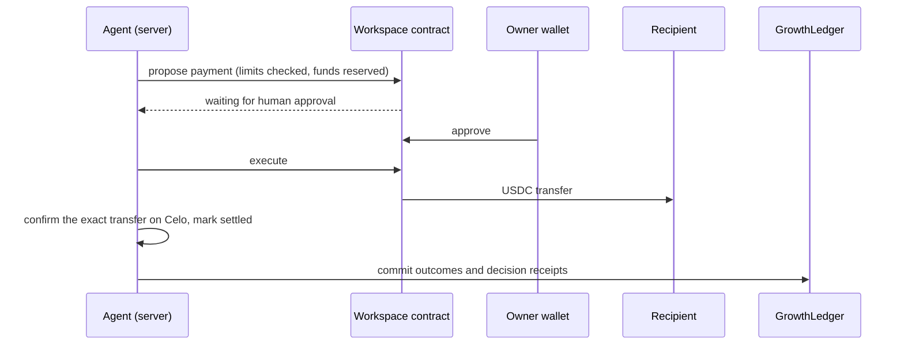
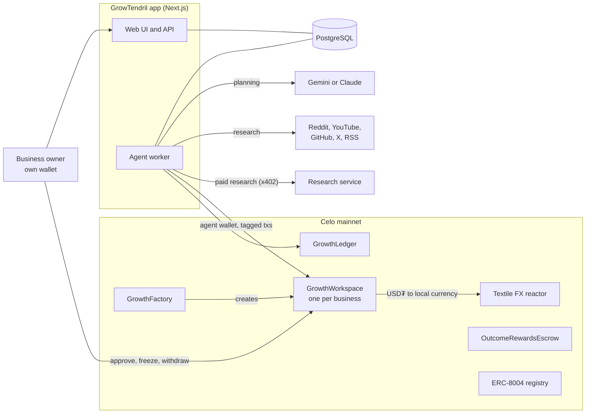

# GrowTendril on Celo

**An AI growth agent for small businesses, with the money and the rules enforced by Celo smart contracts.**

[](https://github.com/drained69/growtendril-celo/actions/workflows/ci.yml)

Live app: [celo.growtendril.xyz](https://celo.growtendril.xyz)

GrowTendril finds customers and creators for a small business, proposes small growth experiments, pays people only under the owner's rules, measures what happened, and moves budget toward what worked.

Every business gets its own workspace contract on Celo. That contract holds the business's USDC and USD₮, its spending limits, its missions and experiments, and its kill switch. The agent can propose payments and carry out approved ones, but it can't pay a person without the owner's approval, can't exceed a limit, and can't withdraw.

## Contents

- [Why](#why)
- [Features](#features)
- [How it works](#how-it-works)
- [Architecture](#architecture)
- [Smart contracts](#smart-contracts)
- [Celo technology used](#celo-technology-used)
- [Tech stack](#tech-stack)
- [Repository structure](#repository-structure)
- [Getting started](#getting-started)
- [Configuration](#configuration)
- [Scripts](#scripts)
- [Testing](#testing)
- [Deployment](#deployment)
- [Security](#security)
- [Status](#status)
- [Hackathon](#hackathon)
- [Documentation](#documentation)
- [License](#license)

## Why

Small businesses want growth, but most can't afford a growth team, and few would hand an AI their wallet. GrowTendril splits the job in two:

- **Offchain, the agent does the work:** research, planning, outreach and measurement.
- **Onchain, the business keeps control:** every limit, approval, payment and recorded result lives in a contract the business owns. Nobody, including GrowTendril, can change it on the business's behalf.

## Features

- **Demand discovery.** Scans public sources (Reddit, YouTube, GitHub, X and RSS) for buying intent, then scores prospective customers and creators.
- **Growth plans, missions and experiments.** Turns a goal and a budget into small experiments with clear success events.
- **Creator campaigns.** Prefunded rewards held in escrow, with a review window and a dispute path.
- **Owner approvals.** Payments to people wait in Approvals. The owner reads the amount and recipient, then signs in their own wallet.
- **Stablecoin payouts.** USDC and USD₮ on Celo, or the recipient's local currency (cNGN, IDRX, wBRL, wARS, wMXN, wCOP) through Textile FX.
- **Paid research.** The agent buys company and market intelligence per request with x402.
- **Outcome measurement.** Cohorts, activation, revenue, CAC, LTV and payback for each experiment. Customer, revenue and refund totals are recorded onchain.
- **Decision receipts.** Every agent decision gets a hashed receipt, committed to a public ledger that anyone can verify.
- **Team and notifications.** Owner, admin, member and viewer roles in the app, email alerts, and a daily brief.
- **Kill switch.** Freeze spending, remove the agent, or withdraw unreserved funds at any time.

## How it works

1. **Discover and plan.** The agent researches demand, scores customers and creators, and drafts an experiment inside a mission budget.
2. **Check policy onchain.** The workspace contract checks the proposed payment against the per-transaction limit, daily limit, category budget and mission budget, and reserves the funds.
3. **Approve.** A payment to a person needs a human approval signed by the owner's own wallet. The agent's key can't approve its own proposals.
4. **Pay.** The agent carries out the approved payment in USDC, or converts USD₮ through Textile FX and delivers in one atomic transaction. A payment is marked settled only after Celo shows the exact transfer.
5. **Record and learn.** Outcomes and decision receipts are committed to a hash-chained ledger, and the agent shifts budget toward what worked.



## Architecture



- **Web and worker** run in the same Node.js process. The worker runs agent jobs on a schedule.
- **The database** stores accounts, research, plans and the payment state machine. Without `DATABASE_URL`, a local PGlite database opens in `.data/`.
- **The agent wallet** is one server key, bound to one workspace. Browsers and language models never see it.
- **The research service** (`services/signals-api`) is an optional paid API. It accepts x402 payments, and only from Self-verified agents.

## Smart contracts

Source: [`contracts/src`](contracts/src). Solidity 0.8.30, optimizer 200 runs, EVM version Cancun.

| Contract | Purpose |
|---|---|
| [`GrowthFactory`](contracts/src/protocol/GrowthFactory.sol) | Creates one isolated workspace contract per business, at an address derived from the owner. It has no owner and can't touch funds. |
| [`GrowthWorkspace`](contracts/src/protocol/GrowthWorkspace.sol) | Holds a business's USDC and USD₮, team roles, spending policy, missions, experiments, payment intents, payouts and kill switch. |
| [`GrowthLedger`](contracts/src/protocol/GrowthLedger.sol) | Hash-chained Merkle checkpoints of receipts, evidence and learnings, plus cumulative experiment outcomes. |
| [`OutcomeRewardsEscrow`](contracts/src/OutcomeRewardsEscrow.sol) | Prefunded creator rewards with a review window, refund hold, single dispute and arbiter timeout. |

The contracts are immutable. There's no admin key, upgrade path, pause key or protocol fee.

**Roles inside a workspace**

| Role | Can | Can't |
|---|---|---|
| Owner | Everything, including withdrawing unreserved funds, even while frozen | Touch another business's workspace |
| Admin | Set policy, open missions, freeze, approve | Withdraw or manage other admins |
| Approver | Approve or reject payments, freeze | Change policy or unfreeze |
| Operator (the agent) | Propose payments within policy, open experiments within budget, add new payees, carry out approved payments, write to the ledger | Approve its own proposals, withdraw, change policy or roles, pay a person without approval, exceed any cap |

**Guarantees enforced onchain**

- Funds reserved for open payments can't be withdrawn until those payments are rejected or expire.
- Mission and experiment spending never exceeds their budgets.
- A payment to a person always needs approval from someone other than the proposer.
- Whoever adds a payee must wait 24 hours before approving a payment to that payee.
- Payments are checked against the policy in force when they execute, so tightening a limit also covers payments already queued.
- A local-currency payout spends at most the approved USD₮, delivers at least the approved minimum, and is atomic.
- Ledger outcome totals only rise, and checkpoints can't fork the hash chain.

**External contracts on Celo mainnet (chain 42220)**

| Asset | Address |
|---|---|
| USDC | `0xcebA9300f2b948710d2653dD7B07f33A8B32118C` |
| USD₮ | `0x48065fbBE25f71C9282ddf5e1cD6D6A887483D5e` |
| Textile FX LimitOrderReactor | `0xa9AA0a64769cBed4d3B1Ceb4Df01CdE915C235b3` |
| ERC-8004 identity registry | `0x8004A169FB4a3325136EB29fA0ceB6D2e539a432` |

**Deployed on Celo mainnet** (November 25, 2026, source verified on Sourcify)

| Contract | Address |
|---|---|
| GrowthFactory | [`0x22d56660f4b1251012f985c38fef07996175f3b1`](https://celoscan.io/address/0x22d56660f4b1251012f985c38fef07996175f3b1) |
| GrowthWorkspace (template behind every workspace) | [`0x5F7E160E292E9Dd0077D9dc6B84Bbcc404F5fb1C`](https://celoscan.io/address/0x5F7E160E292E9Dd0077D9dc6B84Bbcc404F5fb1C) |
| GrowthLedger | [`0x41289019c57389874ee81600c605bdfea671ee5e`](https://celoscan.io/address/0x41289019c57389874ee81600c605bdfea671ee5e) |
| OutcomeRewardsEscrow | [`0x3157ed9d980dd30f419419145c1fcb481789fe15`](https://celoscan.io/address/0x3157ed9d980dd30f419419145c1fcb481789fe15) |

The deployment record, with transaction hashes and a fingerprint of the deployed source, is in [`contracts/deployments/celo-mainnet.json`](contracts/deployments/celo-mainnet.json).

The full trust model, invariants and known limits are in [the protocol notes](docs/celo/PROTOCOL.md).

## Celo technology used

| Area | What GrowTendril uses it for |
|---|---|
| Workspace contracts | Per-business treasury, policy, approvals, payouts and kill switch. |
| Stablecoins | Native USDC and USD₮ on Celo mainnet. |
| Textile FX | Converts approved USD₮ into cNGN, IDRX, wBRL, wARS, wMXN or wCOP, so creators are paid in their own currency. |
| Altana | Optional passkey-owned, non-custodial wallet per workspace, with a capped, expiring session key for the agent. |
| Self Agent ID | Proves a verified human stands behind the agent, and gates the paid research service. |
| ERC-8004 | Agent identity registration, with metadata at [`/.well-known/agent-registration.json`](https://celo.growtendril.xyz/.well-known/agent-registration.json). |
| x402 v2 | The agent pays for research per request in USDC through Celo's facilitator. |
| ERC-8021 | Attribution tags on every agent transaction. |

## Tech stack

| Layer | Tools |
|---|---|
| App | Next.js 15, React, TypeScript, Tailwind CSS |
| Data | PostgreSQL with Drizzle ORM, or PGlite for local development |
| Chain | viem, Foundry (forge, anvil), Solidity 0.8.30 |
| AI | Google Gemini or Anthropic Claude |
| Payments | x402, Textile FX, Celo attribution tags |
| Testing | Vitest, Foundry, a private Celo mainnet fork |
| Hosting | Docker (Node.js 22), Railway |

## Repository structure

```
contracts/                 Solidity contracts, Foundry tests and the deployment record
  src/protocol/            GrowthFactory, GrowthWorkspace, GrowthLedger
  src/                     OutcomeRewardsEscrow
  test/                    Unit tests and a forked-USDC test
src/
  app/                     Next.js routes: marketing site, sign-in, the app (/app/*), API
  components/              UI components
  lib/                     Shared helpers and contract ABIs
  server/
    domain/                Agent, growth, scoring, billing and reconciliation logic
    integrations/celo/     Contracts, Textile FX, x402, Self, Altana, attribution
    jobs/                  Background agent worker
    db/                    Database schema
services/signals-api/      Optional paid research service (x402 and Self)
packages/arc-growth-tools/ Shared toolkit: escrow artifact, outcomes, policy and evidence helpers
scripts/                   Deploy, register, settings upload, end-to-end and readiness scripts
drizzle/                   Database migrations
tests/                     App tests
docs/                      User guide, protocol notes, runbook and validation results
```

## Getting started

### Prerequisites

- Node.js 22.12 or later, 24, or 26
- npm
- [Foundry](https://getfoundry.sh) for the contracts and the fork tests
- Optional: PostgreSQL. Without it, a local PGlite database is used.

### Run the app locally

```sh
git clone https://github.com/drained69/growtendril-celo.git
cd growtendril-celo
npm ci
cp .env.example .env
```

In `.env`, set:

```sh
APP_URL=http://localhost:3000
```

In development, `SESSION_SECRET` and `ENCRYPTION_KEY` are generated automatically under `.data/`. For production, set both: `SESSION_SECRET` needs at least 32 characters, and `ENCRYPTION_KEY` must be 32 bytes. `openssl rand -hex 32` produces a value that works for either.

Then start it:

```sh
npm run dev
```

Open [http://localhost:3000](http://localhost:3000). Integrations you haven't configured stay off and never fabricate results.

### Build the contracts

```sh
cd contracts
forge build
forge test --no-match-contract Fork
```

## Configuration

All settings are environment variables. [`.env.example`](.env.example) lists every one with a short explanation. The main groups:

| Group | Variables |
|---|---|
| Core | `DATABASE_URL`, `APP_URL`, `SESSION_SECRET`, `ENCRYPTION_KEY` |
| Agent wallet | `CELO_AGENT_PRIVATE_KEY`, `CELO_AGENT_PROJECT_ID`, `CELO_ATTRIBUTION_CODE`, `CELO_AGENT_ID`, `CELO_MAINNET_RPC` |
| Contracts | `CELO_GROWTH_FACTORY`, `CELO_GROWTH_LEDGER`, `CELO_REWARDS_ESCROW` |
| Payments | `TEXTILE_API_KEY`, `CELO_RESEARCH_URLS`, `X402_API_KEY`, `SIGNALS_PUBLIC_URL`, `SELF_AGENT_ENABLED`, `BILLING_CELO_ADDRESS` |
| AI | `GEMINI_API_KEY`, `GEMINI_MODEL`, `ANTHROPIC_API_KEY`, `LLM_PROVIDER` |
| Research sources | `GITHUB_TOKEN`, `X_BEARER_TOKEN`, `YOUTUBE_API_KEY`, `REDDIT_*`, `RSS_FEEDS` |
| Email and sign-in | `RESEND_API_KEY`, `EMAIL_FROM`, `OPERATOR_EMAIL`, `GOOGLE_CLIENT_ID`, `GOOGLE_CLIENT_SECRET` |
| Deployment | `CELO_DEPLOYER_PRIVATE_KEY`, `ETHERSCAN_API_KEY` |

Keep every secret on the server. Never prefix one with `NEXT_PUBLIC_`.

## Scripts

| Command | What it does |
|---|---|
| `npm run dev` | Start the app in development mode on port 3000 |
| `npm run build` / `npm start` | Production build and server |
| `npm run typecheck` | TypeScript check |
| `npm test` | App test suite (Vitest) |
| `npm run worker` | Run the agent worker on its own |
| `npm run signals` | Start the optional paid research service |
| `npm run doctor` | Readiness check that names every missing production setting |
| `npm run celo:e2e` | Runs the app against the real contracts on a private Celo mainnet fork |
| `npm run celo:deploy` | Deployment preflight: cost, balance and readiness. Sends nothing |
| `npm run celo:deploy -- --rehearse` | Full deployment and a real-USDC payment on a private fork |
| `npm run celo:deploy -- --broadcast --confirm-mainnet` | Deploy to Celo mainnet. Spends real CELO |
| `npm run celo:deploy -- --verify` | Retry source verification of a finished deployment |
| `npm run celo:register` | Preview the ERC-8004 registration. Add `-- --submit` to send it |
| `npm run celo:env:push` | Upload allowed settings to the hosted app. Never uploads private keys |
| `npm run db:generate` | Generate a database migration |

## Testing

```sh
npm run typecheck
npm test
cd contracts && forge test --no-match-contract Fork && cd ..
npm run celo:e2e
npm run celo:deploy -- --rehearse
```

None of these send a real transaction. `celo:e2e` and `--rehearse` need `anvil` from Foundry, and start a private fork of Celo mainnet. The end-to-end run checks, against the real contracts, that:

- A person can't be paid without the owner's onchain approval, and the server key can't bypass it.
- A payment is marked settled only after Celo shows the exact transfer.
- Rejection frees reserved funds, and the kill switch stops new payments.
- The owner can remove and restore the agent, and withdraw all unreserved funds.
- Outcomes and decision receipts are recorded onchain, and a forged record fails verification.

GitHub Actions runs the type check, app tests, production build and contract tests on every push to `main`.

## Deployment

- **Contracts:** follow [the mainnet runbook](docs/celo/MAINNET_RUNBOOK.md) step by step. Deployment is resumable, tags every transaction, re-reads the deployed settings and publishes the source for verification.
- **App:** the [`Dockerfile`](Dockerfile) builds a Node.js 22 image that serves on port 3000. The hosted app runs on Railway. Upload settings with `npm run celo:env:push`, and add the agent key in the hosting dashboard yourself.
- **Research service (optional):** deploy the same image as a second service with the start command `npm run signals`. See [the launch guide](docs/celo/LAUNCH.md).

## Security

- **The agent key is treated as stealable.** Even with it, an attacker can't withdraw, change limits or roles, approve payments, or pay a person without the owner's approval.
- **The owner is always in control.** From the Wallet page they can freeze spending, remove the agent, and withdraw everything not reserved for an open payment.
- **Settled means settled.** A payment counts as settled only after the exact token transfer appears on Celo.
- **Known limits** are listed in [the protocol notes](docs/celo/PROTOCOL.md#known-limits).

To report a vulnerability, please use GitHub's private security advisory form instead of a public issue.

## Status

The contracts are deployed on Celo mainnet and their source is verified. The contracts and app are also tested end to end on a private fork of Celo mainnet. [Validation results](docs/celo/VALIDATION.md) lists what has passed and what is not yet verified.

## Hackathon

Built for Celo's **Agents Open for Business** hackathon.

Tracks targeted: **Stablecoin Corridors (Textile FX)**, **Self Agent ID** and **Altana Agent Wallets**. Agent Vault is not implemented.

## Documentation

| Document | Contents |
|---|---|
| [User guide](docs/USER_GUIDE.md) | Using the app, from sign-up to approving payments |
| [Protocol notes](docs/celo/PROTOCOL.md) | Contracts, trust model, invariants and known limits |
| [Mainnet runbook](docs/celo/MAINNET_RUNBOOK.md) | Deploying and launching on Celo mainnet |
| [Launch guide](docs/celo/LAUNCH.md) | Hosting, identity, Self, Textile, Altana and the research service |
| [Validation](docs/celo/VALIDATION.md) | Test results and what is not yet verified |

## License

The repository root has no license yet. [`packages/arc-growth-tools`](packages/arc-growth-tools) is licensed under Apache 2.0.
